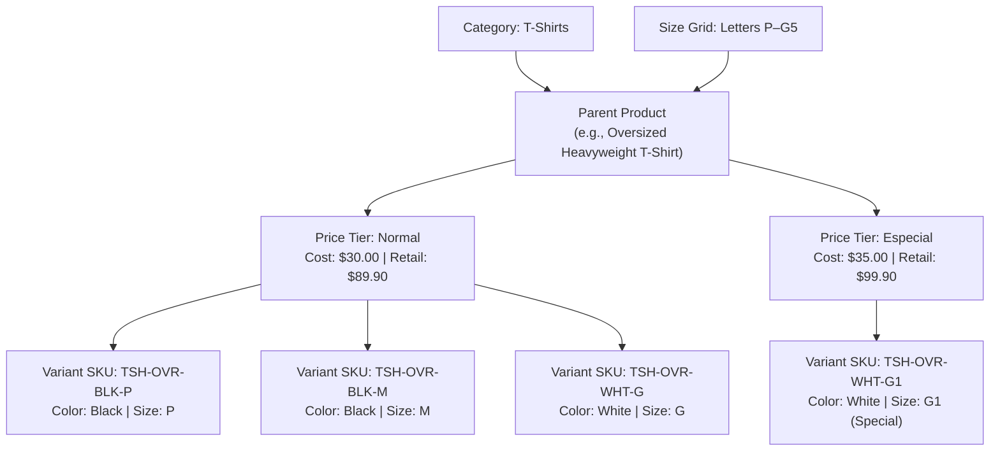
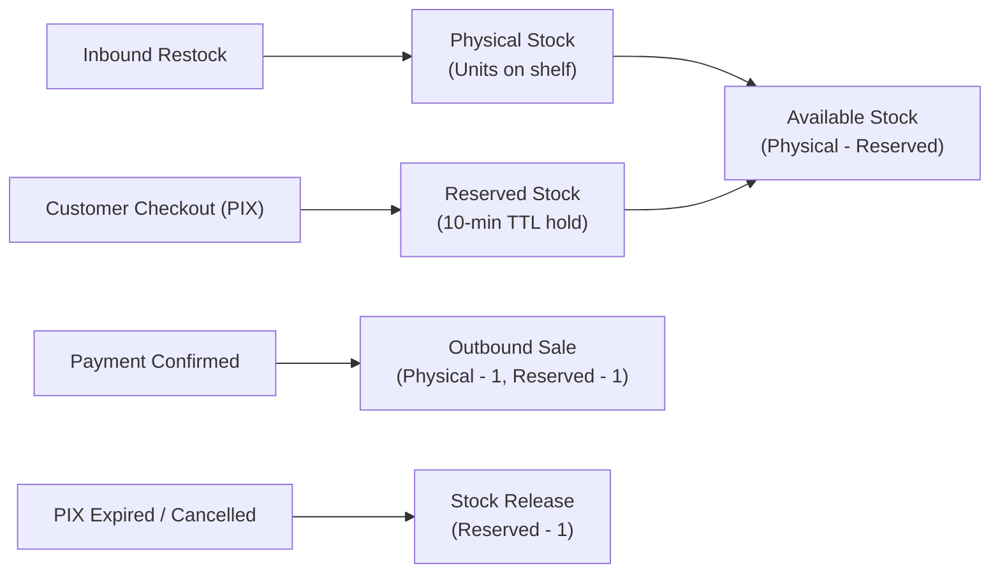

# Minimum Viable Product (MVP) Specification

## 1. Project Overview & Objectives

**ControlStock** is a dedicated inventory management system engineered for apparel (clothing) e-commerce businesses.

### Core Objectives
1. **Engineering Portfolio Showcase:** Demonstrate production-grade backend engineering practices, clean modular architecture, rigorous database modeling, concurrency management, automated test coverage, and clear documentation.
2. **Production-Ready E-commerce Foundation:** Serve as a functional, real-world inventory control engine for an active clothing brand, built to eliminate common pitfalls such as overselling and lack of stock visibility.

---

## 2. Domain Model & Apparel Concepts

Traditional inventory management systems often treat products as single-item entities (`id`, `name`, `quantity`). In apparel retail, this model fails. Clothing items require a **parent-variant structure** (Matrix/Grid):



### 2.1 Parent Product
* **Fields:** `id`, `name`, `slug`, `description`, `category_id`, `size_grid_id`, `brand`, `is_active`, `created_at`, `updated_at`.
* Represents the conceptual garment line. Each product uses one reusable **size grid**.

### 2.2 Apparel Variants (SKU)
* **Fields:** `id`, `product_id`, `price_tier_id`, `size_grid_size_id`, `sku`, `color_name`, `color_hex`, `barcode`, `image_url`, `min_safety_stock`, `is_active`, `created_at`, `updated_at`. Variants hold **no price columns**.
* **Size Grids (`size_grids`, `size_grid_sizes`):** Reusable, ordered size lists shared across products, e.g. letters (`P`, `M`, `G`, `GG`, `G1`…`G5`) or numbers (`38`, `40`, `42`…). Each size may suggest a default price tier (e.g. `G1`+ → "Especial"). A variant's size must belong to its product's grid.
* **SKU Code Generation:** Auto-generated standardized pattern (e.g., `[PRD-SLUG]-[COLOR]-[SIZE]`) with manual override capability.
* **Tier Pricing (`price_tiers`, `tier_prices`):** Each product defines price tiers (e.g. "Normal" and "Especial" for plus sizes); every variant points to exactly one tier of its own product (composite FK). Changing a tier's price updates all its SKUs at once.
* **Price History:** `tier_prices` keeps every `cost_price` / `retail_price` with `valid_from` / `valid_to`; exactly one row per tier is current (`valid_to IS NULL`, partial unique index). The history feeds billing analysis and retail-price suggestions based on cost.
* **UX Image Association:** Images are linked per color variation, allowing frontend clients to update product visuals dynamically when a customer switches color options.

---

## 3. Stock Level Engine & Concurrency Control



### 3.1 Three-Tier Stock Levels (`stock_levels`)
One row per variant, created automatically when the variant is inserted. To prevent overselling (*selling inventory that does not exist or is already committed*):
1. **Physical Quantity (`physical_qty`):** Total real units physically present in the stockroom/warehouse.
2. **Reserved Quantity (`reserved_qty`):** Units held for unfinalized checkouts pending payment confirmation.
3. **Available Quantity (`available_qty`):** A stored generated column, calculated as:
   $$\text{Available} = \text{Physical} - \text{Reserved}$$
   This is the exact number exposed to the e-commerce storefront for customer purchase.

### 3.2 Payment & Reservation Policies
* **Instant Payments (Credit / Debit Cards):** Immediate settlement. Decrements `physical_qty` directly upon transaction approval.
* **Asynchronous Payments (PIX):**
  * Initiating checkout locks the required units under `reserved_qty` with a **10-minute Time-To-Live (TTL)**.
  * Payment webhook confirmed within 10 minutes $\rightarrow$ converts reservation into confirmed sale: decrements both `physical_qty` and `reserved_qty`.
  * TTL elapsed without payment $\rightarrow$ release event: decrements `reserved_qty`, returning the units to `available_qty`.
* **Bank Slips (Boleto):** Excluded from MVP scope to avoid prolonged inventory holds.

### 3.3 Zero-Negative Guarantee (Strict Database Integrity)
The system strictly prohibits negative stock quantities under any circumstances. Enforced via database-level check constraints:
```sql
CONSTRAINT ck_stock_levels_physical_non_negative CHECK (physical_qty >= 0);
CONSTRAINT ck_stock_levels_reserved_non_negative CHECK (reserved_qty >= 0);
CONSTRAINT ck_stock_levels_reserved_lte_physical CHECK (reserved_qty <= physical_qty);
```

---

## 4. Immutable Inventory Ledger (Audit Trail)

Stock levels are never modified with arbitrary `UPDATE` statements. The application only **inserts** `inventory_movements`; the database keeps `stock_levels` in sync:

* `trg_inventory_movements_apply` applies each movement's `physical_delta` / `reserved_delta` to `stock_levels` in the same transaction (the row update also serializes concurrent writers on the same SKU).
* `trg_stock_levels_guard` / `trg_stock_levels_no_truncate` reject any direct `INSERT` / `UPDATE` / `DELETE` / `TRUNCATE` on `stock_levels`.
* `trg_inventory_movements_immutable` / `trg_inventory_movements_no_truncate` reject `UPDATE`, `DELETE` and `TRUNCATE` on the ledger.
* CHECK constraints enforce the rules per movement type (delta signs, mandatory prices, reasons, notes, reservation and order references); a composite FK `(reservation_id, variant_id)` ensures a movement's reservation belongs to the same SKU.

### Unit Prices on Movements
* `purchase_unit_cost`: mandatory on `INBOUND_PURCHASE` — what one piece actually cost in that batch.
* `sale_unit_price`: mandatory on `OUTBOUND_SALE` — what one piece was actually sold for (may differ from the tier's current retail price, e.g. discounts).

### Movement Types
| Type Code | Stock Impact | Description |
| :--- | :--- | :--- |
| `INBOUND_PURCHASE` | `+ physical_qty` | Arrival of manufactured/purchased batch from suppliers. Records `purchase_unit_cost`. |
| `OUTBOUND_SALE` | `- physical_qty` (and `- reserved_qty` when confirming a PIX reservation) | Order payment settled. Units deducted permanently. Records `sale_unit_price`. |
| `STOCK_RESERVE` | `+ reserved_qty` | Customer initiates PIX checkout. Units held for 10 minutes. |
| `STOCK_RELEASE` | `- reserved_qty` | PIX expired or customer cancels checkout prior to payment. |
| `CUSTOMER_RETURN` | `+ physical_qty` | Return or size exchange accepted back into inventory. Requires mandatory classification reason. |
| `LOSS_DEFECT` | `- physical_qty` | Garment damaged, fabric flawed, or lost. Deducted with reason note. |
| `INVENTORY_ADJUSTMENT` | `+/- physical_qty` | Stockroom physical count reconciliation (cycle count). |

### Mandatory Customer Return Reasons
Garment returns must be classified to diagnose supplier quality and pattern grading issues:
* `WRONG_SIZE` (Customer ordered incorrect size / pattern runs small/large)
* `FABRIC_DEFECT` (Manufacturing defect, seam tear, color bleeding)
* `NOT_AS_PICTURED` (Color or styling differs from expectations)
* `CUSTOMER_REGRET` (Standard statutory withdrawal)

---

## 5. Functional Requirements (FR)

### Module 1: Product & Apparel Matrix Management
* **FR-01:** The system shall allow creating, updating, retrieving, and deactivating parent products and categories.
* **FR-02:** The system shall generate variant combinations (size $\times$ color) under a parent product.
* **FR-03:** The system shall auto-generate unique SKU codes following the pattern `[PRODUCT_SLUG]-[COLOR]-[SIZE]` while permitting manual overrides.
* **FR-04:** The system shall store cost and retail prices per product price tier, with full price history, and link each variant to one tier.
* **FR-05:** The system shall associate image references to specific color variants.

### Module 2: Transactional Stock Management
* **FR-06:** The system shall register inbound purchase shipments (`INBOUND_PURCHASE`), updating physical quantities and logging supplier unit purchase costs.
* **FR-07:** The system shall create temporary stock reservations (`STOCK_RESERVE`) with a 10-minute expiration for PIX checkouts.
* **FR-08:** The system shall release expired reservations (`STOCK_RELEASE`) back to available stock.
* **FR-09:** The system shall confirm sales (`OUTBOUND_SALE`), atomically decrementing physical and reserved quantities.
* **FR-10:** The system shall register garment returns (`CUSTOMER_RETURN`) requiring a structured reason.
* **FR-11:** The system shall register inventory adjustments and fabric loss/defects (`LOSS_DEFECT`).

### Module 3: Alerts, Metrics & Valuation
* **FR-12:** The system shall evaluate stock levels against `min_safety_stock` thresholds and provide a queryable list of items in critical rupture status.
* **FR-13:** The system shall compute total inventory valuation:
  * Total physical units in stock.
  * Total invested capital ($\sum (\text{physical\_qty} \times \text{cost\_price})$), using the current price of each variant's tier.
  * Total gross retail potential ($\sum (\text{physical\_qty} \times \text{retail\_price})$), using the current price of each variant's tier.
  * Projected gross margin percentage.
* **FR-14:** The system shall provide filtering of stock positions by **Category** and **Stock Status** (`IN_STOCK`, `LOW_STOCK`, `OUT_OF_STOCK`).

---

## 6. Non-Functional Requirements (NFR)

* **NFR-01 (ACID Transactions & Row Locking):** All stock mutations and reservations must execute inside strict database transactions with pessimistic row-level locking to prevent race conditions during concurrent checkouts. The `stock_levels` row is locked by the movement trigger's `UPDATE`, so concurrent reservations of the same SKU queue up; explicit `SELECT ... FOR UPDATE` is only needed when the application reads quantities before deciding.
* **NFR-02 (Zero Negative Stock):** Guaranteed at both the application domain layer and database constraint layer.
* **NFR-03 (Automated Test Coverage):** Minimum of 80% test coverage across unit tests (business rules) and integration tests (database transactions, API endpoints).
* **NFR-04 (API Specification & Contracts):** 100% compliant OpenAPI 3.1 / Swagger documentation generated directly by FastAPI via Pydantic schemas.
* **NFR-05 (Stateless Architecture):** The backend API must be entirely stateless, container-ready, and configurable strictly via environment variables.

---

## 7. Architecture & Directory Blueprint

```text
ControlStock/
├── .github/
│   └── workflows/
│       └── ci.yml                     # GitHub Actions CI for Ruff & Pytest
├── docs/
│   └── MVP.md                         # This specification document
├── src/
│   └── control_stock/
│       ├── __init__.py
│       ├── main.py                    # FastAPI application entrypoint
│       ├── models.py                  # Registry importing every ORM model (Alembic, tests)
│       ├── core/                      # Core configuration and database engine
│       │   ├── config.py              # Environment variables via pydantic-settings
│       │   └── database.py            # SQLAlchemy engine, session maker, base model
│       └── modules/                   # Domain modules (clean modular structure)
│           ├── products/              # Categories, products, size grids, price tiers
│           │   ├── models.py
│           │   ├── schemas.py
│           │   ├── services.py
│           │   └── router.py
│           ├── variants/              # Apparel variants, sizes, and SKUs
│           │   ├── models.py
│           │   ├── schemas.py
│           │   ├── services.py
│           │   └── router.py
│           ├── inventory/             # Stock levels, reservations, and ledger
│           │   ├── models.py
│           │   ├── schemas.py
│           │   ├── services.py
│           │   └── router.py
│           └── reports/               # Stockout alerts and financial valuation
│               ├── schemas.py
│               ├── services.py
│               └── router.py
├── migrations/                        # Alembic database migration scripts
├── tests/
│   ├── conftest.py                    # Pytest fixtures and test database setup
│   ├── unit/                          # Isolated business rule unit tests
│   └── integration/                   # Endpoint and transactional database tests
├── .env.example                       # Documented environment variables template
├── docker-compose.yml                 # Local development PostgreSQL service
├── Dockerfile                         # Container build instructions
├── requirements.txt                   # Production dependencies
└── README.md                          # Repository landing page
```

---

## 8. Technology Decisions & Rationale

| Decision | Selected Choice | Rationale |
| :--- | :--- | :--- |
| **Language** | Python 3.11+ | Clean syntax, robust static typing (`typing`, `Self`), high developer velocity. |
| **API Framework** | FastAPI | High async performance, automatic Swagger/OpenAPI documentation, seamless Pydantic integration. |
| **Validation** | Pydantic v2 | Rust-core serialization and deserialization, strict runtime validation. |
| **Persistence** | SQLAlchemy 2.0 | Modern declarative syntax (`Mapped`, `mapped_column`), explicit transaction control, robust connection pooling. |
| **Database** | PostgreSQL 16 | Relational standard for transactional integrity, row-level locks, and domain check constraints. |
| **Migrations** | Alembic | Track, audit, and roll forward/backward database schema modifications. |
| **Container** | Docker Compose | Ensures identical local development environment across contributors. |
| **CI / Quality** | Ruff + Pytest | Millisecond-level linting and formatting; comprehensive automated test execution in CI. |
| **Frontend** | React / Next.js | Modern, responsive client dashboard for store operations and management (planned for Phase 8). |
